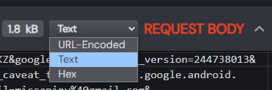

# Google Photos Uploader

Monitor a folder and upload photos and videos to Google Photos using
[GPMC](https://github.com/xob0t/gpmc) without consuming storage space. Supports local folders and host-mounted SMB/NAS shares, with Docker images for AMD64 and ARM64.

GPMC uses a reverse-engineered mobile API. Storage accounting and authentication
are controlled by Google and may change; verify the results in your own account.

## File handling

- **Originals are kept by default**, including after failed or unconfirmed uploads.
- JPG, JPEG, PNG, HEIC, MP4 and MOV are supported, including uppercase extensions.
- Existing files are scanned at startup and periodically. New files, modifications
  and renames are also detected using polling. Symbolic links are excluded.
- Nonempty files must remain unchanged for `STABLE_SECONDS` before uploading.
- An upload is confirmed only when GPMC returns a media key for that exact path.
  The file's identity, size and timestamps are checked again after upload.
- SQLite records pending work and confirmed uploads. Unchanged completed files
  are skipped after restart. GPMC also checks remote duplicates by content hash.
- Errors use exponential backoff. After `MAX_ATTEMPTS`, the file stays on disk;
  reconciliation can reactivate it after the `RETRY_MAX` cooldown.

**Optional deletion:** setting `DELETE_AFTER_UPLOAD=true` permits removal only
following confirmation and a check that the source has not changed. Confirmation
is committed before removal, so a failed removal can be retried after restart
without repeating the upload. Use a dedicated upload folder and keep backups.

Changing the Google account, watched folder or deletion mode resets the local
queue's scope and rescans the source. Files are confirmed remotely again before
they can be removed under a newly enabled deletion setting. Refreshing credentials
for the same account preserves the queue. Remote hash checks avoid duplicate uploads.

File stability is a heuristic: a copy paused longer than the configured interval
can appear complete. For reliable ingestion, copy to an unsupported temporary
extension such as `.tmp` in the same directory, close the file, then rename it to
its final `.jpg` or `.mp4` name. Avoid modifying files while they are being uploaded.

## Getting started

Requirements: Docker with Compose, a readable photo folder and authentication
data obtained below. Mount SMB/NAS shares **on the host** before starting Compose.

1. Copy `.env.example` to `.env` and fill in your credentials and folder:

   ```dotenv
   AUTH_DATA='androidId=...&Email=...&Token=...'
   PHOTO_FOLDER=./photos
   DELETE_AFTER_UPLOAD=false
   ```

   The authentication string must contain the complete captured request; the
   example above is abbreviated. `.env`, `secrets/` and `photos/` are ignored by Git.
   The Docker build context includes only the required application files.

2. Create the photo folder or verify that your host-mounted NAS folder exists.
   Compose deliberately does not create a missing source directory.

3. Start and inspect the service:

   ```bash
   docker compose up -d
   docker compose logs -f
   docker compose ps
   ```

4. Stop it with `docker compose down`. The named `uploader-state` volume persists
   the queue, confirmations, health status and GPMC cache. Keep it on local
   storage; SQLite should not be placed on an SMB/NFS share. `down -v` deletes it.

The container runs as UID/GID 1000. The photo directory needs read/search
permissions, plus write permission if deletion is enabled. The state volume must
always be writable. If you override the runtime UID/GID, adjust the state volume's
ownership as well. One service instance should own each state volume.

## Configuration

Compose passes these options from `.env` or the host environment. Direct Python
runs read the same environment variables. Invalid values fail before workers start.

| Variable | Default | Purpose |
| --- | --- | --- |
| `AUTH_DATA` | empty | Complete authentication request; required unless using a file |
| `AUTH_DATA_FILE` | empty | Container path to an authentication file; mutually exclusive with `AUTH_DATA` |
| `PHOTO_FOLDER` | `./photos` | Host bind-mount source, used by Compose |
| `DELETE_AFTER_UPLOAD` | `false` | Explicitly enable source deletion; accepts `true` or `false` |
| `STABLE_SECONDS` | `5` | Time a nonempty file must remain unchanged |
| `STABILITY_TIMEOUT` | `300` | Maximum wait for a stable file per attempt |
| `SCAN_INTERVAL` | `60` | Interval between reconciliation scans |
| `POLL_INTERVAL` | `1` | Watchdog polling interval |
| `REQUEST_TIMEOUT` | `60` | Per-request timeout passed to GPMC; its internal retries can extend an operation |
| `MAX_ATTEMPTS` | `5` | Failed attempts before cooldown |
| `RETRY_BASE` | `5` | Initial retry delay |
| `RETRY_MAX` | `3600` | Maximum retry delay and cooldown duration |
| `SHUTDOWN_TIMEOUT` | `120` | Grace period for in-flight work before forced process exit |
| `LOG_LEVEL` | `INFO` | DEBUG, INFO, WARNING, ERROR or CRITICAL |

All durations are in seconds and must be positive. `MAX_ATTEMPTS` and
`REQUEST_TIMEOUT` must be integers. `STABILITY_TIMEOUT` must be at least
`STABLE_SECONDS`; `RETRY_MAX` must be at least `RETRY_BASE`. If you increase
`SHUTDOWN_TIMEOUT`, also increase Compose's `stop_grace_period` (default: 150s).

`WATCHED_FOLDER` and `STATE_DIR` default to `/data` and `/state` in the container.
They must be separate, non-overlapping directories. Compose fixes them to match
its mounts. For direct Python runs, set both to appropriate local paths.
`GP_AUTH_DATA` is also accepted for direct runs as a fallback to `AUTH_DATA`.

### Authentication from a mounted secret

To keep credentials out of the container environment, leave `AUTH_DATA` empty in
`.env`, save the full request in `secrets/auth_data.txt`, and add a
`compose.override.yaml` containing:

```yaml
services:
  gphotos-uploader:
    environment:
      AUTH_DATA: ""
      AUTH_DATA_FILE: /run/secrets/gphotos_auth
    secrets:
      - gphotos_auth
secrets:
  gphotos_auth:
    file: ./secrets/auth_data.txt
```

Ensure the runtime user can read the file. Keep this file private. Known input
tokens are redacted in application logs; avoid sharing credentials or debug logs.

Load the secret override explicitly with both files:

```bash
docker compose -f docker-compose.yml -f compose.override.yaml up -d
```

Use the same `-f` options for subsequent Compose commands. See the
[Docker documentation on merging Compose files](https://docs.docker.com/compose/how-tos/multiple-compose-files/merge/).

## Health and recovery

A heartbeat checks that the worker and Watchdog emitter are alive and the watched
folder can be accessed. Missing folders and stopped observers are retried; a
reconnected observer triggers reconciliation. Heartbeats older than 30 seconds
are unhealthy. Docker checks every 15 seconds after its startup grace period.

```bash
docker compose exec gphotos-uploader python /app/script_gphoto.py --healthcheck
```

An unhealthy status alone does not trigger a restart under Docker Compose. The
service attempts reconnection itself; fatal worker failures exit so the restart
policy can take effect. A filesystem call stuck in the kernel may need host
intervention. A readable empty host mountpoint does not prove the NAS is mounted.
Health also does not prove Google authentication or a previous upload succeeded;
check upload confirmation and retry messages in the logs.

SIGINT and SIGTERM request an orderly stop. Work and confirmations remain in
SQLite. An in-flight GPMC operation may finish within `SHUTDOWN_TIMEOUT`; after
that the process exits and the next startup resumes pending work.

## How to get your authentication data

Store the captured request securely. Authentication may need to be refreshed if
Google rejects or revokes it.

### ✅ Option 1 – ReVanced (No Root Required)

1. Install Google Photos ReVanced on your Android device:  
   - Install [GmsCore](https://github.com/ReVanced/GmsCore/releases)  
   - Install the patched APK from [here](https://github.com/j-hc/revanced-magisk-module/releases) or patch it yourself  
2. Connect your device to your PC via ADB.
3. Run the following in your terminal:

    **Windows:**
    ```cmd
    adb logcat | FINDSTR "auth%2Fphotos.native"
    ```

    **Linux/macOS:**
    ```bash
    adb logcat | grep "auth%2Fphotos.native"
    ```

4. If you've used ReVanced before, remove your Google Account from GmsCore.
5. Launch Google Photos ReVanced and log into your account.
6. You should see logs appear in your terminal.
7. Copy the full line starting from `androidId=` to the end. That’s your `AUTH_DATA`! 🎉

---

### 🛠 Option 2 – Official Google Photos App (Root Required)

<details>
  <summary><strong>Click to expand</strong></summary>

1. Use a rooted Android device or emulator (Android 9–13 recommended).
2. Connect your device to your PC via ADB.
3. Install [HTTP Toolkit](https://httptoolkit.com).
4. In HTTP Toolkit, go to **Intercept → Android Device via ADB**.
5. Apply the filter:

    ```text
    contains(https://www.googleapis.com/auth/photos.native)
    ```

    Or for older versions:

    ```text
    contains(www.googleapis.com%2Fauth%2Fplus.photos.readwrite)
    ```

6. Open Google Photos and log into your account.
7. Look for the captured request and copy the **request body** as plain text.  
   
8. That’s your `AUTH_DATA`! 🎉

</details>

---

## Building and updating

The default Compose file runs the published image. To apply local source changes:

```bash
docker build -t ghcr.io/giuseppe99barchetta/google-photos-uploader:latest .
docker compose up -d --force-recreate --pull never
docker compose logs -f
```

Run these commands from the repository root. A subsequent `docker compose pull`
replaces your local image with the published one. The build checks dependency
compatibility and imports as `appuser` before producing the image.

To update from the registry:

```bash
docker compose pull
docker compose up -d --force-recreate
```

Images are also tagged by commit SHA and release tag. Select an available
commit tag in Compose when you need predictable upgrades or a rollback.

## Development and checks

Python 3.11 or newer is required. Create a virtual environment, then run:

```bash
python -m pip install -r requirements-dev.txt
python -m pip check
python -m ruff check .
python -m unittest discover -s tests -v
```

Tests use temporary files and fake credentials; they do not contact Google.
They cover preservation, stability, reconciliation, persistent retries, cleanup
recovery, polling, health, logging and shutdown. CI runs on Windows and Linux
with Python 3.11 and 3.12, then runs the tests as the container runtime user.
Publishing on the default branch or version tags waits for these checks.

For a direct run, set `AUTH_DATA` or `AUTH_DATA_FILE`, `WATCHED_FOLDER`, and a
separate writable `STATE_DIR`, then run `python script_gphoto.py`.
